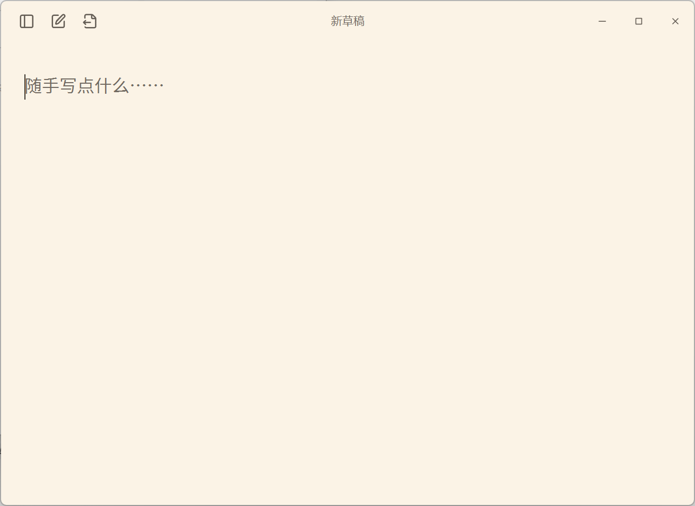

# 随手笺 / MdTxt v0.1.0

一个离线的 Windows 草稿本。快捷呼出，打开就写，内容默认自动保存在本机。

## 开始使用

适用于 Windows 11 x64。发布包自带必要的 .NET 桌面运行时，无需另装 .NET 或 SDK。

下载 `MdTxt-v0.1.0-win-x64.zip`，完整解压后，打开 `MdTxt` 文件夹中的 `MdTxt.exe`。请保留同目录的其他文件。

## 界面预览

## 简单用法

- 侧边栏中创建、切换、重命名、置顶或删除草稿；置顶内容显示在「常用笺」。
- 支持导入、导出 TXT / Markdown；均按纯文本处理，导入不直接改写原文件。
- 点击窗口 × 会结束当前会话，程序继续驻留托盘；再次打开默认进入新空白页，旧稿保留在历史中。
- 托盘图标可打开窗口；右键选择「退出程序」可彻底退出。
- 关闭自动保存后，结束会话会丢弃未持久化的修改。需要保留时，可先导出。

快捷键：新建 `Ctrl+N`，导入 `Ctrl+O`，导出 `Ctrl+Shift+S`，调节字号 `Ctrl++` / `Ctrl+-`。

默认全局呼出键为 **Alt+A**，可在设置中修改或禁用。

## 默认设置与数据

首次使用：自动保存开启、打开新空白页、侧边栏收起、思源黑体 20 DIP（可调 10–50）、暖纸白背景。

草稿与个人设置保存在 `%LOCALAPPDATA%\MdTxt`，发布包不附带开发者的草稿和设置。已有用户升级后会继续使用自己的设置。

不需要账号、网络连接，不会自动添加开机启动。需要备份时，先退出程序，再复制上述数据目录。

## 版本与许可

v0.1.0 为首个发布版本，提供本地草稿、自动保存、托盘、快捷键、置顶、字体与配色设置以及 TXT/MD 导入导出。

第三方组件及思源黑体的许可说明随软件提供，见解压后的 `licenses` 目录。
